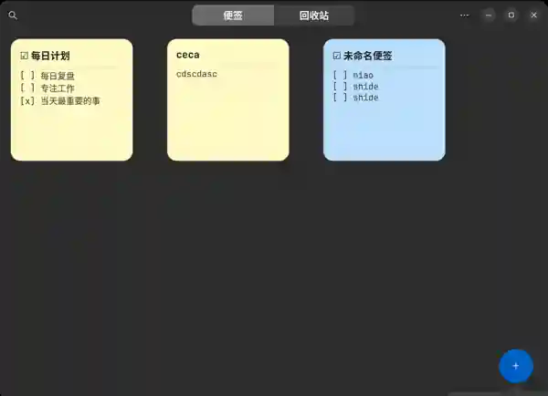
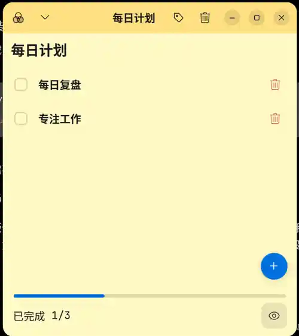
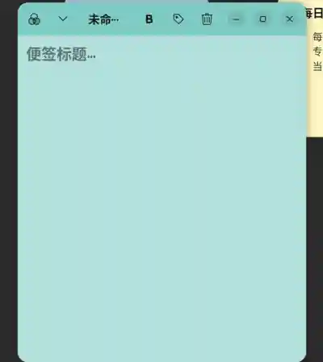
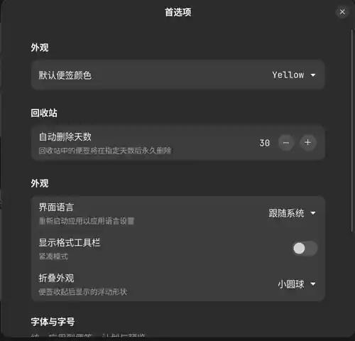

<div align="center">

# 🗒️ PinPlan Notes · 轻笺

**一张悬浮便签，记录灵感；一份待办清单，逐项完成。**

*An open-source sticky notes and checklist app for Ubuntu & Linux desktops.*

[](https://github.com/lbg2002/betternotes/releases/latest)


**[⬇ 直接下载 v0.4.6 · Ubuntu / Debian DEB](https://github.com/lbg2002/betternotes/releases/download/v0.4.6/pinplan-notes_0.4.6_all.deb)**

[🖼️ 界面预览](#界面预览) · [✨ 功能](#核心功能) · [🚀 使用指南](#快速上手) · [🌍 English](#english-quick-start)

</div>

| 🗂️ **普通便签** | ☑️ **计划清单** | 🫧 **悬浮小球** | 🔐 **离线保存** |
| :---: | :---: | :---: | :---: |
| 颜色、标签、富文本、搜索 | 拖动排序、完成进度、截止日期 | 单击收起或展开，随手放在桌面角落 | SQLite 本地数据，JSON 备份，无需注册 |

> **v0.4.6 正式稳定版**：依据 Ubuntu 26.04 GNOME 桌面的实际使用反馈，取消折叠/展开时的复杂坐标定位和等待，恢复点击即切换的小圆球/圆角长条模式。窗口展开位置交给桌面窗口管理器决定。其余计划、便签、字体、搜索与备份功能保持兼容。

## v0.4.7 新功能（候选版）

- **轻量 Markdown 预览：** 普通便签可以直接粘贴 `# 标题`、`**加粗**`、列表、勾选项、引用、行内代码、代码围栏、简单表格、链接等 Markdown 文本。点击便签标题栏的**预览图标（眼睛）**查看格式化效果，再点击**编辑图标**返回源文本。无需安装 WebKit 或其他 Markdown 依赖。预览不更改原文和本地数据库。
- **随时返回主界面：** 普通便签和计划窗口标题栏新增**小房子图标**。即使关闭了主界面，点它也能重新打开；如果主界面仍在，则只切换过去，不会重复创建。折叠的小圆球或长条还支持**右键打开主界面**。
- **适用范围：** 采用 GTK 原生文本预览，支持常用 Markdown 文字排版，但**不是完整 CommonMark、HTML、数学公式或图片渲染引擎**。复杂 Markdown、嵌套语法和图片仍按原文保存，需要用专门的 Markdown 阅读器显示。

## 界面预览

以下截图来自实际运行的 PinPlan Notes（已适度压缩为 WebP）。

| 便签管理主界面 | 计划清单 |
|:--:|:--:|
|  |  |
| **主界面：** 彩色便签、计划卡片、搜索和回收站 | **计划模式：** 拖拽排序、勾选、进度与悬浮加号 |

| 普通便签 | 首选项 |
|:--:|:--:|
|  |  |
| **便签模式：** 编辑文字、颜色与标签 | **偏好设置：** 语言、字体、字号和折叠外观 |

> **项目来源与许可：** PinPlan Notes（轻笺）基于 [0xpaperhead/BetterNotes](https://github.com/0xpaperhead/betternotes) 开源项目开发，遵守 GPL-3.0-or-later，并保留原项目及贡献者的版权署名。这是非官方的社区增强版本；Debian 包名称现为 `pinplan-notes`，为了兼容旧版，内部应用 ID 和数据目录仍沿用上游命名。

## 🎬 三步使用

1. **新建便签**：点击主界面右下角 **+ → 新建便签**，记录想法，内容自动保存。
2. **新建计划**：选择 **+ → 新建计划**，添加待办、拖拽排序、勾选完成，查看进度。
3. **一键折叠**：便签标题栏的收起按钮可将窗口变成小圆球或圆角长条，点击即可恢复。

> 适合写作灵感、论文阅读摘录、学习待办、日常工作提醒。操作尽量留在桌面，不强制切换至任务管理平台。

## 为什么做「轻笺」

临时想法和长期计划不应该挤在一个复杂的任务管理软件中。PinPlan 专注于**像便利贴一样留在桌面的两个小窗口**：随手记录的便签，以及可以逐项打勾的计划。无需账号、无需联网、无需额外数据库服务器。

## 核心功能

| 功能 | 普通便签 | 计划清单 |
|:--|:--:|:--:|
| 桌面独立窗口、置顶 | ✅ | ✅ |
| 折叠为可拖动小圆球 / 圆角长条、单击还原 | ✅ | ✅ |
| 8 种颜色及深色主题 | ✅ | ✅ |
| 自定义标题和标签 | ✅ | ✅ |
| 全局字体、字号实时调整 | ✅ | ✅ |
| 搜索、回收站、自动保存 | ✅ | ✅ |
| 加粗 / 斜体 / 下划线 / 删除线 / 列表 | ✅ | — |
| 格式工具栏默认隐藏、按需展开 | ✅ | — |
| 轻量 Markdown 原文编辑 / 渲染预览切换 | ✅ | — |
| 从窗口图标返回或重开主界面 | ✅ | ✅ |
| 添加 / 编辑 / 删除条目 | — | ✅ |
| 勾选完成并自动加删除线 | — | ✅ |
| 按住任务文字拖动排序 | — | ✅ |
| 完成项浅灰背景、可折叠已完成 | — | ✅ |
| 点击文字编辑、失焦/回车完成输入 | — | ✅ |
| 截止日期、软件运行时的到期提醒 | — | ✅ |
| 底部已完成数量、进度条及图标折叠 | — | ✅ |
| Enter 连续创建下一条任务 | — | ✅ |
| 删除单条任务后撤销（20 步） | — | ✅ |

**其他特性**：简体中文 / 英语 / 跟随系统；保留标签筛选、全文搜索、撤销部分删除操作；所有便签本地存储于 SQLite，无广告、无注册、无云端同步。

> 置顶由上游的 XWayland/X11 机制实现。GNOME 原生 Wayland 不允许普通应用任意控制置顶层级，因此应用保留 XWayland 启动方式以维持置顶。不同桌面环境仍需实测。

## 快速上手

### 下载与安装

**[⬇ 下载 pinplan-notes_0.4.6_all.deb](https://github.com/lbg2002/betternotes/releases/download/v0.4.6/pinplan-notes_0.4.6_all.deb)**（[查看 Release 说明](https://github.com/lbg2002/betternotes/releases/tag/v0.4.6)），然后在下载目录运行：

```bash
sudo apt install ./pinplan-notes_0.4.6_all.deb
```

从应用菜单搜索 **PinPlan Notes / 轻笺** 启动。

Debian 软件包名为 **`pinplan-notes`**，安装时可以替换原 `betternotes-lite` DEB。原有便签数据库保持不变；升级前建议先导出 JSON 备份。**Snap 版与 DEB 版的用户数据可能位于不同目录，不能假设自动迁移。**

该 DEB **不捆绑 Python、GTK4、Libadwaita 运行库**，由 apt 按需使用系统依赖。因此 DEB 很小，**不代表装完依赖后只占几十 KB**。Ubuntu 26.04 / GNOME 50 建议先备份旧便签后升级。

### 普通便签模式

点击主界面右下角 **+**，选择「新建便签」。输入标题及正文；顶部可选择颜色或标签，点击格式按钮显示/隐藏加粗、斜体等工具栏。文字会自动保存。关闭窗口并不会删除内容。

### 计划清单模式

同样点击 **+** →「新建计划」，或按 `Ctrl+Shift+N`。

1. 点击右下角圆形 **+** 输入一条待办；**输入文字后按 Enter 会立即新增下一条**，点击空白处则只结束编辑。空白任务按 Enter / 失焦会自动取消。
2. 勾选条目前的复选框：标记完成、显示删除线；再点一次恢复未完成。
3. 直接**点击文字编辑**，按住文字**拖动到另一条任务上**即可调整顺序；仅保留红色删除图标。右键点击任务文字可以设定或清除截止日期。
4. 底部显示「已完成 x/y」与细进度条，右侧有**眼睛图标**可以收起/展开已完成任务；已勾选项目会划线并显示灰色背景。内容、顺序及日期自动保存到本地。
5. 可像普通便签一样修改颜色、标签和标题，窗口置顶行为保持一致。

**说明**：删除单条任务可使用进度条旁出现的「撤销」按钮恢复，支持本次窗口会话最近 20 次删除（包括原顺序与截止日期）；关闭窗口后不保留单条任务的撤销历史。仍建议定期导出备份。到期提醒仅在 PinPlan 正在运行时检查，默认每 15 分钟一次；关闭应用不会保留后台提醒服务。

### 折叠小球 / 圆角长条

每张普通便签和计划窗口标题栏左上方的**调色板右侧**增加收起按钮。点击即可变成一个独立、紧凑的小窗：

- 默认**小圆球**（约 58 × 58 px）；也可在**主界面 → 首选项 → 外观 → 折叠外观**选**圆角长条**（约 188 × 46 px，显示标题）。
- **点击**小球/长条可恢复原便签编辑窗口；**拖动**可放到屏幕角落。每张便签都可以独立收起，普通便签和计划一致。
- 收起前自动保存编辑内容；原编辑窗口保持在内存，展开时保留文本、滚动状态等。原有 XWayland 置顶逻辑继续用于浮动窗。**v0.4.6 起不再追踪小球位置**；点击后原便签立即显示，由窗口管理器决定位置（GNOME 通常居中），没有等待或后续位置微调。
- 形状选择是**全局偏好**，在下次收起时生效。关闭或退出程序后不会自动恢复收起状态；需重新打开便签。不同 Linux 桌面环境的表现可能不同。
- 圆形视觉效果需要桌面合成器支持透明窗口；GNOME/XWayland 实际圆角和跨屏移动体验建议自行验证。

### 计划模板与数据备份

主界面右下角 **+ → 计划模板** 可新建「每日计划」「每周计划」「学习计划」，模板只是可自由编辑的初始清单。

主界面右上角菜单提供 **导出备份 / 导入备份**：

- 导出为本地 `pinplan-backup.json`，包括便签、计划、颜色、标签和回收站记录，不依赖云服务。
- 导入会先校验文件，再一次性合并记录；**已有相同 ID 的便签不会被覆盖**。请妥善保管备份，因为可能包含个人信息。
- 导入导出使用系统文件选择窗口，不需要数据库软件；现有便签也仍然使用 SQLite 自动保存。

### 快捷键

| 快捷键 | 功能 |
|:--|:--|
| `Ctrl+N` | 新建普通便签 |
| `Ctrl+Shift+N` | 新建计划 |
| `Ctrl+B / I / U / D` | 普通便签内的加粗 / 斜体 / 下划线 / 删除线 |
| `Ctrl+,` | 打开设置 |
| `Ctrl+Q` | 退出 |

如需设定截止日期，**右键点击计划项文字**打开日历。日期到期或逾期时，仅在软件运行期间发送桌面通知。

在主界面右上角菜单打开 **首选项 → 字体与字号**，可选择电脑中已安装的字体，使用字号调节器设置 **10–32 px**，预览区会实时更新，已打开的便签和计划也同步生效。点击「恢复默认」可以重新使用系统字体与默认大小。**不修改现有便签的保存格式或内容。**

首选项还可选择界面语言、是否显示格式工具栏。切换语言后需重新启动程序。

## 旧版数据与安全升级

由于上游 Snap 包与系统 DEB 可能使用**不同的隔离数据目录**，不要假定升级后旧便签会自动显示。**先关闭 BetterNotes/PinPlan，再备份数据库与 WAL 文件**：

```bash
find "$HOME/snap/betternotes" "$HOME/.local/share/betternotes" \
  -name 'notes.db*' -type f -print 2>/dev/null
```

记录实际路径，并复制**整个数据库所在文件夹**到安全目录。Snap 数据可能位于 `~/snap/betternotes/current/.local/share/betternotes/`；本地 DEB 通常使用 `~/.local/share/betternotes/`。确认两个程序均退出后再迁移，避免并发写入 SQLite 数据库。新版对 `notes` 表仅新增有默认值的 `kind` 字段，旧便签仍归类为普通便签。

> 不要直接用 `sudo rm -rf` 删除旧 Snap 数据；确认新版本中所有内容完整后，再自行决定是否清理旧应用。

## 从源码构建

```bash
sudo apt update
sudo apt install python3 python3-gi gir1.2-gtk-4.0 gir1.2-adw-1 \
  libgtk-4-dev libadwaita-1-dev meson ninja-build gettext \
  libglib2.0-dev-bin desktop-file-utils
git clone https://github.com/lbg2002/betternotes.git
cd betternotes
meson setup build --prefix=/usr
meson compile -C build
```

运行自动化测试：

```bash
PYTHONPATH=src /usr/bin/python3 -m unittest discover -s tests -v
```

项目使用 Python 3、GTK4、Libadwaita、SQLite/FTS5 和 Meson，保持轻量并尽量复用 Linux 发行版已有依赖。GitHub Actions 会执行静态检查、测试和 DEB 构建。不要把**CI 构建成功**误认为已完成每一种 Linux 桌面环境的 GUI 实测。

## English quick start

PinPlan Notes is a small, local-first sticky notes and checklist application for the Linux desktop, derived from BetterNotes.

- **Sticky notes:** rich text, optional compact toolbar, colors, tags, full-text search, trash and automatic saving.
- **Floating compact notes:** Collapse ordinary notes and plans into draggable always-on-top circles or rounded pills; click to restore immediately, without coordinate polling or placement delays. Choose shape in Preferences.
- **Checklists:** tasks begin immediately under the title; completion count, progress and the icon-only completed-item toggle sit in the bottom footer. Click to edit, drag to reorder, press Enter for the next task, and undo deletion. Right-click for optional due dates.
- **Desktop:** individual always-on-top windows through XWayland/X11, with instant collapse/restore and desktop-managed expanded-window placement.
- **Typography:** live font-family and font-size (10–32px) preferences for notes, checklists and previews, with system-default reset.
- **Localization:** Simplified Chinese, English, or system language.
- **Templates & backups:** daily/weekly/study presets, local JSON export and additive import.
- **Reminders:** notifications for due/overdue tasks while the app is running (no resident daemon).
- **Privacy:** SQLite local storage, no account or network requirement.

Download the Debian package from [Releases](https://github.com/lbg2002/betternotes/releases) and install with `sudo apt install ./pinplan-notes_*.deb`. Use **+** to choose a sticky note or a checklist. Existing Snap installs may have separate storage; back up your notes before migrating.

## 致谢与 AI 辅助开发

PinPlan Notes 的需求设计、功能增强、交互优化、代码修改、自动化测试和 README / Release 整理工作，在开发者的指导与反复实机测试反馈下，得到了 **OpenAI GPT-6** 的辅助。

> **AI-assisted development:** GPT-6 assisted with feature design, implementation, debugging, test development and documentation. The repository maintainer reviewed requirements and tested the application in real desktop environments.

感谢 [BetterNotes 原作者及贡献者](https://github.com/0xpaperhead/betternotes)、GTK / GNOME 开源社区，以及提供反馈的用户。GPT-6 辅助开发并不改变原项目的许可证、作者署名或开源归属。

## 维护与反馈

欢迎通过 [Issues](https://github.com/lbg2002/betternotes/issues) 报告错误或提出小功能需求。请提交系统版本、桌面环境、安装方式及可复现步骤，**勿公开私人便签数据库**。

原始项目：[0xpaperhead/betternotes](https://github.com/0xpaperhead/betternotes)；遵守 [GPL-3.0-or-later](LICENSE) 条款。PinPlan 是基于原项目的非官方社区扩展版本。
