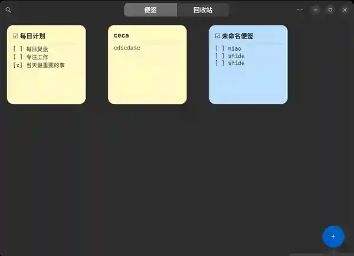
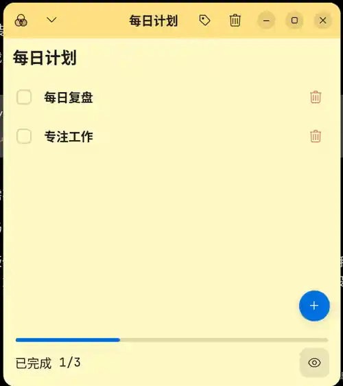
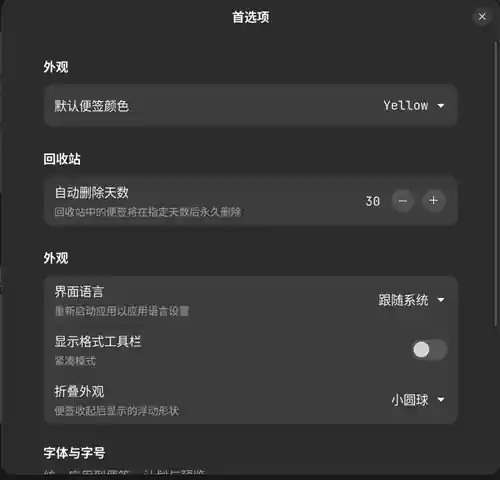

## PinPlan Notes v0.4.8

- 改用桌面默认显示后端，减少经 XWayland 的输入链路。Wayland 下由桌面管理窗口置顶。
- 中文组词期间暂停自动保存。编辑内容后合并便签列表刷新，避免重建标签和回收站。
- 「首选项 → 关于」新增版本显示、GitHub 稳定版检查及 DEB 应用内更新。安装前校验 SHA-256，成功后重新打开应用。
- 包含 v0.4.7 候选版的 Markdown 预览和返回主界面按钮。

Ubuntu / Debian 用户可下载 `pinplan-notes_0.4.8_all.deb` 安装或覆盖升级。
# PinPlan Notes · 轻笺 v0.4.6

**正式稳定版 / Stable release**

轻量、离线、支持简体中文与英语的 Linux 桌面便签和任务清单工具。本版本已经根据 Ubuntu 26.04 GNOME 环境的实际使用反馈调整折叠交互。

## 本版重点 / Highlights

- **即时折叠与展开：** 便签和计划可以收起为可拖动的小圆球或圆角长条，点击立即还原。
- **更稳定的窗口行为：** 移除透明等待、重复坐标修正和延迟展开；窗口位置由 GNOME / 窗口管理器决定。
- **计划清单：** 勾选完成、灰色完成态、拖拽排序、Enter 连续创建、进度条、收起完成项、删除撤销。
- **常用功能：** 富文本便签、8 种颜色、标签、搜索、字体与字号、中文设置、计划模板、截止日期提醒、JSON 备份导入导出。
- **轻量 DEB：** 使用发行版提供的 Python/GTK4/Libadwaita 共享依赖，不捆绑大型运行时。
- **兼容已有数据：** 保留内部应用 ID 和原有 SQLite 数据路径。

## 界面预览 / Screenshots

| 主界面 | 计划清单 |
|:--:|:--:|
|  |  |

| 普通便签 | 首选项 |
|:--:|:--:|
|  |  |

## 下载和安装 / Installation

下载下面的 **`pinplan-notes_0.4.6_all.deb`** 附件，在下载目录执行：

```bash
sudo apt install ./pinplan-notes_0.4.6_all.deb
```

适用于兼容依赖的 Ubuntu / Debian 桌面；主要针对 Ubuntu 26.04 GNOME 的实际反馈优化。升级前建议先在软件中**导出 JSON 备份**。原 `betternotes-lite` DEB 可以通过 apt 替换，Snap 版可能使用独立数据目录，**不会自动迁移**。

**注意：** DEB 文件体积不包含 apt 安装的系统 GTK/Python 依赖。置顶依赖 XWayland/X11 机制；不同窗口管理器的定位行为可能不同。

## 致谢 / Acknowledgements

PinPlan Notes 是从 [0xpaperhead/BetterNotes](https://github.com/0xpaperhead/betternotes) 派生的非官方社区项目，继续遵循 **GPL-3.0-or-later** 许可并保留上游贡献者署名。感谢用户提供测试与交互反馈。本项目的功能规划、代码修改、问题分析、测试设计和说明文档得到 **OpenAI GPT-6** 辅助。

*GPT-6 assisted feature planning, code refinement, test development and documentation. Credit to the original BetterNotes contributors and the community maintainer.*

更多说明：[README](https://github.com/lbg2002/betternotes#readme) · [Issues](https://github.com/lbg2002/betternotes/issues)
